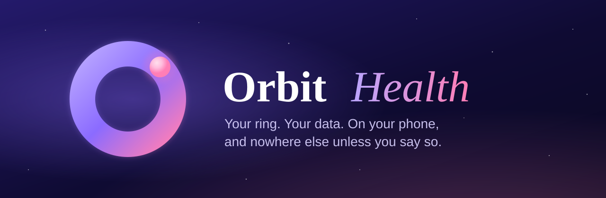

<p align="center">
  
</p>

<p align="center">
  <a href="LICENSE"></a>
  
  
  
  
</p>

<p align="center">
  <b>A calm, private health app for cheap smart rings. Sleep, heart, HRV, SpO₂, stress and steps, kept on your phone. No account, no vendor cloud.</b>
</p>

---

Cheap smart rings are good hardware held back by their apps. The one that ships with many of them sends your sleep, heart rate and blood oxygen to the vendor's servers, and asks for an account before it shows you anything.

**Orbit Health** talks to the ring directly over Bluetooth and keeps everything on your phone, in an encrypted database. It gives you readiness, sleep stages, heart and HRV trends, SpO₂, stress and activity in an interface that's meant to feel calm rather than clinical.

> **Part of the Orbit family**: open-source, local-first apps that keep your data on your own devices. One promise across all of them: *your hardware, your data, no vendor cloud in the middle.* Read more at **[orbitapps.space](https://orbitapps.space)**.

## Features

**Everything your ring records**
- **Sleep** with deep, light, REM and awake stages, a sleep score, the night's lowest heart rate, HRV and SpO₂.
- **Readiness** that learns your baseline over your first three nights.
- **Heart rate, HRV, SpO₂, stress and steps**, with day and week views and long-term trends.

**Sleep the ring missed** (new in 0.7)
- When the ring didn't record a night (or a nap), Orbit Health estimates it from your heart rate and movement and **asks you to confirm or adjust** it. Confirmed estimates fill the gap and are always marked as estimates.

**Measure now**
- On-demand readings of **heart rate, SpO₂, HRV, stress and blood pressure**, with a live value while the ring measures.
- Blood pressure and stress are **estimates** from the ring's optical sensor, and always labelled ESTIMATE.

**Automatic checks**
- Choose how often the ring measures by itself, from the options your ring actually supports, and see what the ring accepted.

**Private by design**
- No analytics, ads or tracking SDKs, and no account or sign-in.
- Data lives in an encrypted on-phone database and is excluded from Android backups.
- An optional app lock (fingerprint, face or PIN).
- **Export** of all your data is coming in the next update; until then, a paired Orbit Server can export everything as JSON.
- **Updates from GitHub** (new in 0.7): the app checks this repository's releases at most once a day (you can turn that off in Me → App updates), verifies the download is signed with the same key, and installs it with your approval. Each check is listed in the app's network log.

**Your own server and AI, if you want them**
- **[Orbit Server](https://github.com/Kno2gether-Labs-LTD/orbit-server)** is a small self-hosted companion, now its own project (it also powers the OrbitWalker voice agent). Pair your phone and it pushes your data to *your* server over HTTPS with a pinned certificate. This repository keeps a copy of the server for building everything together; new server features land in [orbit-server](https://github.com/Kno2gether-Labs-LTD/orbit-server) first. Guides: [orbitapps.space/docs](https://orbitapps.space/docs/).
- From there you get a private dashboard and an **MCP endpoint**, so AI agents you run can read your health data under scopes you set, with every access logged in the app.

## Supported rings

| Family | Tested | Notes |
|---|---|---|
| **YCBT** (Yucheng protocol, vendor app *SmartHealth*) | TK5 | The app picks the ring automatically when you pair. Other YCBT rings should work; please [tell us](../../issues/new/choose). |

Orbit Health is built so that more rings, cheap and premium, can be added as separate driver modules without touching the app. See **[Adding a ring](docs/adding-a-ring.md)**.

**Before you pair, uninstall the ring's vendor app.** A ring talks to one app at a time, and while the vendor app is installed Orbit Health never clears the ring's memory, to stay out of its way.

## Getting Orbit Health

<p align="center">
  <a href="https://github.com/Kno2gether-Labs-LTD/orbit-health/releases/latest/download/OrbitHealth.apk"></a>
</p>

**[Download the latest APK](https://github.com/Kno2gether-Labs-LTD/orbit-health/releases/latest/download/OrbitHealth.apk)** (Android 12+), or see all versions under [Releases](https://github.com/Kno2gether-Labs-LTD/orbit-health/releases).

1. Open the downloaded file on your phone and allow your browser or Files app to install it. Play Protect may warn you because the app isn't from the Play Store.
2. Open Orbit Health, put your ring on, and follow the pairing steps.
3. Wear the ring tonight. Readiness appears after three nights.

Every release is signed with the same key, so updates install over the previous version. The SHA-256 checksum of each APK is listed on its release page.

**Orbit Health is not a medical device.** Its readings are for general wellbeing and are not meant to diagnose, treat or prevent any condition.

### Build it yourself

```bash
# Requirements: JDK 17+, Android SDK 35
./gradlew test
./gradlew :app:assembleDebug
adb install app/build/outputs/apk/debug/app-debug.apk
```

Release builds read their signing key from `~/.gradle/gradle.properties` (`ORBITHEALTH_RELEASE_*` or `ORBIT_RELEASE_*`); without one they stay unsigned.

## How it works

```
ring ──Bluetooth LE──▶ ring family driver (:ring-ycbt) ──▶ ring-agnostic records (:ring-core)
                                                              │
                     encrypted on-phone database ◀── sync engine (app)
                              │                               │
                    Compose UI (Today, Sleep, Body, Ask, Me)   └──▶ optional: your Orbit Server (:server)
                                                                     dashboard · MCP for your own agents
```

| Module | What's inside |
|---|---|
| `ring-core/` | The ring contract: families, registry, capabilities, measurement and monitoring, plus a fake family for tests |
| `ring-ycbt/` | The YCBT protocol: framing, CRC, commands, history decoders and the driver |
| `app/` | Bluetooth, storage, sync and the Jetpack Compose app |
| `sync-protocol/` | Wire format shared by the app and the server |
| `server/` | Orbit Server (Ktor): pairing, dashboard, agent access and MCP |
| `deploy/` | Docker Compose and Caddy for running Orbit Server on a VPS |
| `tools/` | Python helpers for protocol work with a real ring from a computer |

The verified YCBT commands are documented in [docs/protocol/ycbt-settings.md](docs/protocol/ycbt-settings.md).

## Roadmap

- More ring families, starting with the most common cheap rings, then premium rings with documented protocols.
- Rings without an open protocol through Health Connect.
- Richer insights that stay on the phone.

## Built by Kno2gether Labs

Orbit Health and the Orbit family are designed and built by **[Kno2gether Labs LTD](https://kno2gether.com)**, the team behind **[Knotie](https://knotie-ai.pro)**.

We build apps like this one, websites, and **custom AI solutions** for businesses: from private, on-device AI to agents that work with your own data. If you'd like something built, get in touch at [kno2gether.com](https://kno2gether.com) or see what Knotie can do at [knotie-ai.pro](https://knotie-ai.pro).

## Contributing

Thank you for the interest! **Contributions aren't open yet**: the project is still being set up and maintainer time is limited, so pull requests can't be reviewed for now. Feedback is very welcome: open an issue with your ring, phone and what you saw. See [CONTRIBUTING.md](CONTRIBUTING.md).

To report a security problem privately, see [SECURITY.md](SECURITY.md).

Video guides: [youtube.com/@Kno2gether](https://www.youtube.com/@Kno2gether)

## License

[Apache-2.0](LICENSE). Third-party components are listed in [NOTICE](NOTICE).

Orbit Health is an independent project, not affiliated with or endorsed by any ring maker or the makers of their apps. Product names are trademarks of their owners.
